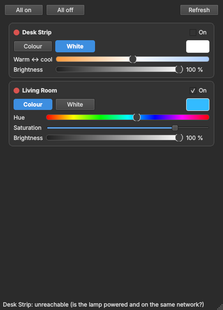
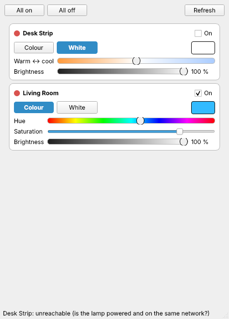

# Tuya Lamps

Control your **Tuya Wi-Fi smart lamps** (bulbs and LED strips paired in the
Smart Life or Tuya Smart app) **locally over your LAN** from Linux. Nothing goes
through the cloud after the one-time setup.

Tuya Lamps comes in three parts:

- **Desktop app**: a small PySide6 (Qt 6) window with one card per lamp
- **CLI**: `tuya-lamps list` / `tuya-lamps set …` with JSON output, handy for
  scripts and keybindings
- **KDE Plasma 6 widget**: a panel icon with a popup holding the same controls

It works on any Linux desktop. It was written on openSUSE Tumbleweed (Wayland)
with Qtile and KDE Plasma 6.

## Screenshots

| Desktop app (Qtile, dark) | Desktop app (system theme) |
|---|---|
|  |  |

*Plasma widget screenshots (Oxygen, Breeze, Breeze Dark): coming soon.*

<!-- Add e.g. screenshots/widget-oxygen.png and screenshots/widget-breeze-dark.png here. -->

## Features

- Local control with [TinyTuya](https://github.com/jasonacox/tinytuya). No cloud
  is needed after the setup.
- On/off, **colour** (hue, saturation, exact colour picker) and **white**
  (warm ↔ cool) modes, plus brightness
- Controls a lamp doesn't support are hidden automatically
- The network never freezes the window. Each lamp has its own worker thread, and
  while you drag a slider only the latest value is sent.
- A status dot per lamp: grey = unknown, green = online, red = unreachable
- All on / All off / Refresh
- Follows your KDE theme (e.g. Oxygen) on Plasma, and uses a built-in dark
  theme elsewhere (e.g. Qtile)
- A Plasma 6 widget that matches Oxygen, Breeze and Breeze Dark. Middle-click
  the panel icon to toggle all lamps.

## Requirements

- Linux with Python **3.9 or newer** (`python3`, including the `venv` module)
- Tuya Wi-Fi lamps, already paired in the **Smart Life** (or Tuya Smart) app
- A free **Tuya IoT developer account**, needed once to get the local keys
- For the widget: **KDE Plasma 6**

The Python packages (`tinytuya`, `PySide6`) are installed into a private
virtual environment. That is needed on openSUSE Tumbleweed and other distros
where system pip is "externally managed".

## Install

```bash
git clone https://github.com/elegast707/tuyaforlinux.git
cd tuyaforlinux
./install.sh            # desktop app + CLI
./install.sh --plasma   # ... and the KDE Plasma 6 widget
```

The installer:

- creates a venv in `~/.local/share/tuya-lamps/venv` and installs the requirements
- copies the app to `~/.local/share/tuya-lamps/`
- creates the launcher `~/.local/bin/tuya-lamps`
- adds **Tuya Lamps** to your application menu
- creates the config folder `~/.config/tuya-lamps/`
- with `--plasma`: installs the widget with `kpackagetool6`

If `~/.local/bin` is not on your `PATH`, the installer tells you how to add it.

To remove everything (your `~/.config/tuya-lamps/` is kept):

```bash
./uninstall.sh
```

## One-time setup: getting the local keys

Every Tuya lamp has a secret **local key**. TinyTuya's wizard downloads these
keys once from the Tuya cloud. After that, everything runs locally.

1. **Pair your lamps** in the Smart Life app (if you haven't already). Use your
   own account, not a guest account.
2. **Create a Tuya IoT account** at <https://iot.tuya.com>. When asked for an
   "Account Type", choose *Skip this step…*.
3. **Create a cloud project**: click *Cloud* → *Create Cloud Project*. Choose the
   **data centre that matches your Smart Life account region**. In the
   Netherlands (and most of Europe) that is **Central Europe**. If no devices
   show up later, the data centre is usually wrong.
4. Make sure the project has the **IoT Core** and **Authorization** API
   services. Write down the **Access ID** and **Access Secret** shown in the
   project *Overview*.
5. **Link the Smart Life app**: in your project go to *Devices* → *Link Tuya App
   Account* → *Add App Account*, choose *Automatic* and *Read Only Status*, and a
   QR code appears. In the Smart Life app on your phone, open the **Me** tab and
   tap the **QR icon** in the top right, then scan the code. Your lamps now
   appear in the project.
6. **Run the wizard** inside the config folder, with the venv's Python:

   ```bash
   cd ~/.config/tuya-lamps
   ~/.local/share/tuya-lamps/venv/bin/python -m tinytuya wizard
   ```

   Enter the Access ID, Access Secret and region (`eu` for Central Europe).
   Answer **yes** when it asks to poll the devices: that creates
   `snapshot.json` with the current IP addresses, which makes connecting
   faster.

> [!IMPORTANT]
> The wizard creates `devices.json`, `snapshot.json`, `tinytuya.json` and
> `tuya-raw.json`. These files contain your **local keys and API secret**. Keep
> them private and never share or commit them. This repository's `.gitignore`
> already excludes them.

Note: the Tuya IoT Core trial expires after a while. You only need it when you
run the wizard again (e.g. after re-pairing a lamp); local control keeps
working without it.

Tuya Lamps reads `~/.config/tuya-lamps/devices.json`. To use another folder,
set `TUYA_LAMPS_DIR=/path/to/folder`.

## Firewall

TinyTuya finds lamps on the network through UDP broadcasts (ports 6666, 6667
and 7000) and talks to them over TCP port 6668. On openSUSE (firewalld):

```bash
sudo firewall-cmd --permanent --add-port=6666/udp --add-port=6667/udp --add-port=7000/udp --add-port=6668/tcp
```

```bash
sudo firewall-cmd --reload
```

Your PC and the lamps must be on the same network (broadcasts don't cross
VLANs or guest networks).

## Using the CLI

All commands print JSON.

```bash
tuya-lamps                # open the desktop app (same as: tuya-lamps gui)
tuya-lamps list           # all lamps and their state
```

```bash
tuya-lamps set "Living Room"                       # switch on
tuya-lamps set "living room" --off                 # names are case-insensitive
tuya-lamps set all --off                           # every lamp
tuya-lamps set "Desk Strip" --brightness 40        # keep the current mode
tuya-lamps set "Desk Strip" --colour 210 80        # blue-ish (hue 0-359, saturation 0-100)
tuya-lamps set "Desk Strip" --color 0 100 --brightness 50
tuya-lamps set "Living Room" --white 0 --brightness 70   # warmest white (0 = warm, 100 = cool)
```

- `set` accepts a lamp **id**, a lamp **name** or `all`
- `--brightness` with `--colour` sets the colour's brightness. With
  `--white` it sets both.
- `--brightness 0` switches the lamp off
- The exit code is `1` when a lamp fails, so you can use it in scripts

Example output of `tuya-lamps set "Desk Strip" --white 30`:

```json
{
  "id": "bf0123456789abcdefgh",
  "name": "Desk Strip",
  "ok": true,
  "error": null
}
```

### Qtile keybinding

In `~/.config/qtile/config.py`:

```python
from libqtile.config import Key
from libqtile.lazy import lazy

keys += [
    # Open the Tuya Lamps window
    Key([mod], "l", lazy.spawn("tuya-lamps")),
    # Switch all lamps on / off
    Key([mod, "shift"], "l", lazy.spawn("tuya-lamps set all --on")),
    Key([mod, "control"], "l", lazy.spawn("tuya-lamps set all --off")),
]
```

If Qtile can't find the command, use the full path
`~/.local/bin/tuya-lamps` (Qtile does not expand `~`, so write it as
`os.path.expanduser("~/.local/bin/tuya-lamps")`).

### Theme

On KDE, the app uses your system Qt style (for example Oxygen). Elsewhere it
uses Fusion with a built-in dark palette. To force one or the other:

```bash
TUYA_LAMPS_THEME=dark tuya-lamps
```

```bash
TUYA_LAMPS_THEME=system tuya-lamps
```

## The Plasma widget

1. Install it with `./install.sh --plasma`.
2. Right-click your panel → **Add or Manage Widgets…** (or *Enter Edit Mode*
   → *Add Widgets…*).
3. Search for **Tuya Lamps** and drag it onto the panel.

Left-click the lightbulb to open the controls. **Middle-click** toggles all
lamps (if any lamp is on, all go off). The popup refreshes every 30 seconds
while it is open. You can change that in the widget settings (right-click →
*Configure Tuya Lamps…*).

After updating the widget, restart Plasma to load the new version:

```bash
systemctl --user restart plasma-plasmashell
```

To try the widget without adding it to the panel (needs the Plasma SDK,
`sudo zypper install plasma6-sdk` on openSUSE):

```bash
plasmoidviewer -a io.github.elegast707.tuyalamps
```

## Troubleshooting

**The desktop app does not open (`libgthread-2.0.so.0: cannot open shared object file`)**
PySide6 brings its own Qt, but Qt still needs this small GLib library, which
openSUSE Tumbleweed doesn't always install. Install it:

```bash
sudo zypper install libgthread-2_0-0
```

Run `tuya-lamps` in a terminal to see why the app doesn't start. The CLI and
the Plasma widget work without Qt.

**A lamp shows a red dot / "unreachable"**
- Is the lamp powered (wall switch on) and connected to Wi-Fi? Check it in the
  Smart Life app.
- Is your PC on the same network as the lamp, and is the firewall open (see
  [Firewall](#firewall))?
- The lamp's IP address may have changed. Run the wizard again and answer yes
  to polling, or give the lamp a fixed IP address in your router.

**"wrong local key or protocol version"**
A lamp that was removed and paired again in the Smart Life app gets a **new
local key**. Run the wizard again (see [One-time setup](#one-time-setup-getting-the-local-keys)).

**It works sometimes, or only from one app**
Some lamps allow only **one local connection** at a time. Close other apps or
integrations that talk to the lamp locally (e.g. Home Assistant's LocalTuya,
another TinyTuya script, or the desktop app while you test the CLI).

**The widget says "Command not found"**
Plasma may not have `~/.local/bin` on its `PATH`. Open the widget settings and
set the command to the full path `~/.local/bin/tuya-lamps`. Also check that
`./install.sh` finished without errors.

**The widget says "No lamps configured"**
`~/.config/tuya-lamps/devices.json` is missing. Run the wizard as described
above.

## License

[GNU General Public License v3.0](LICENSE) © Daniël Veen
